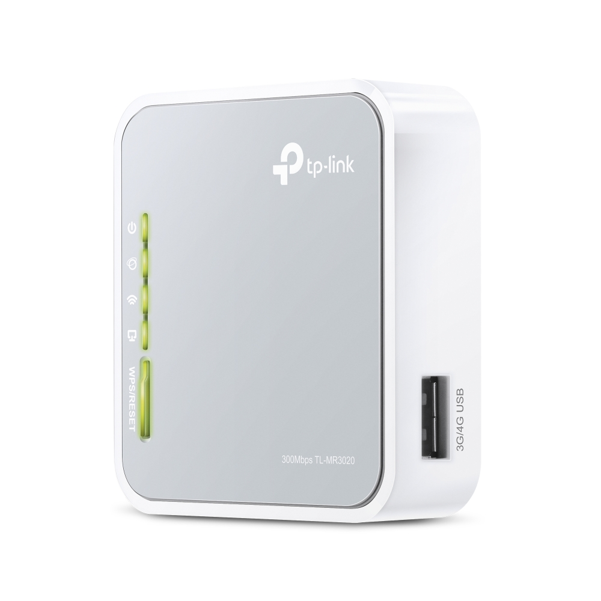
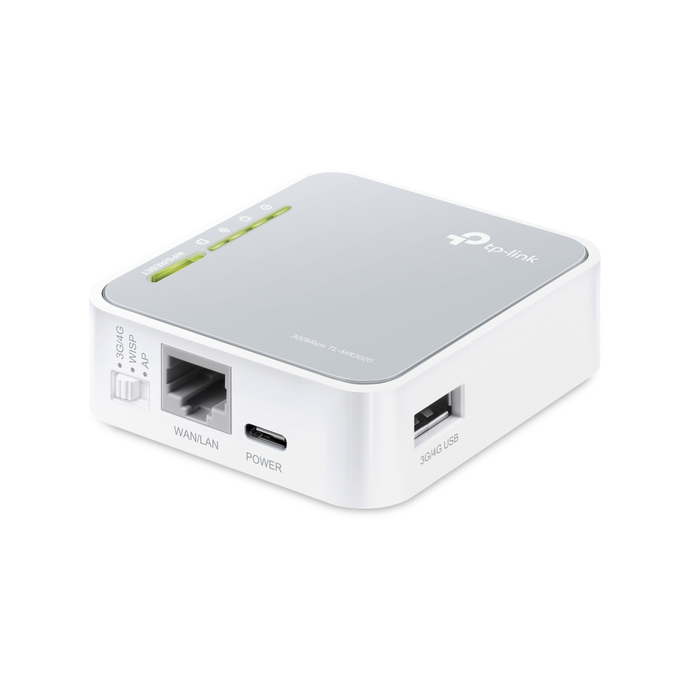
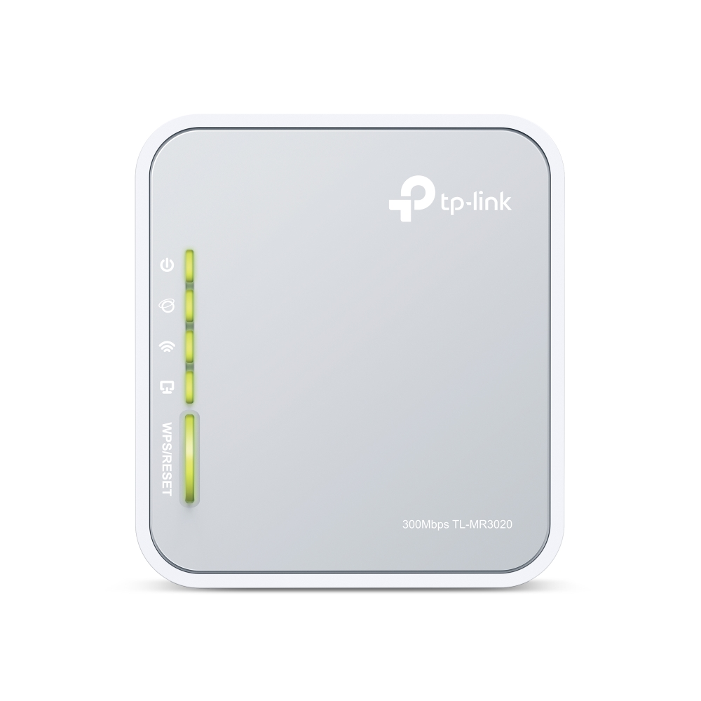
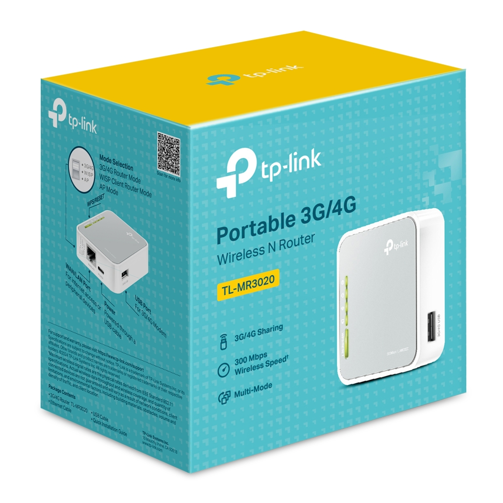
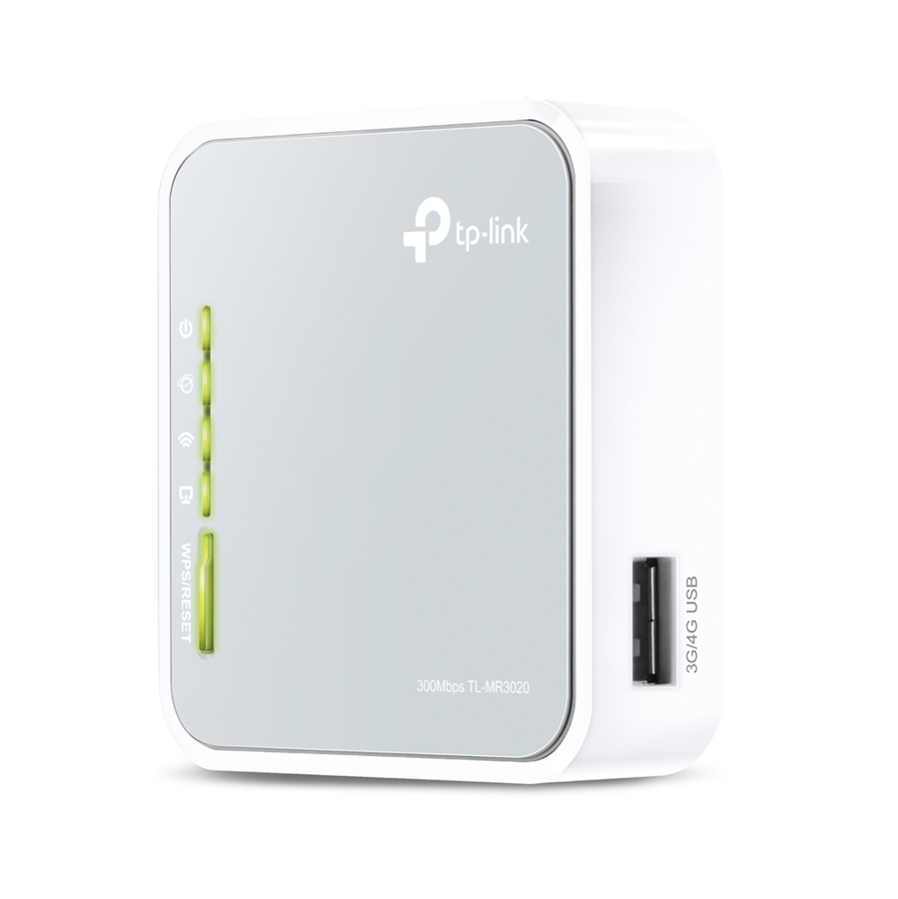
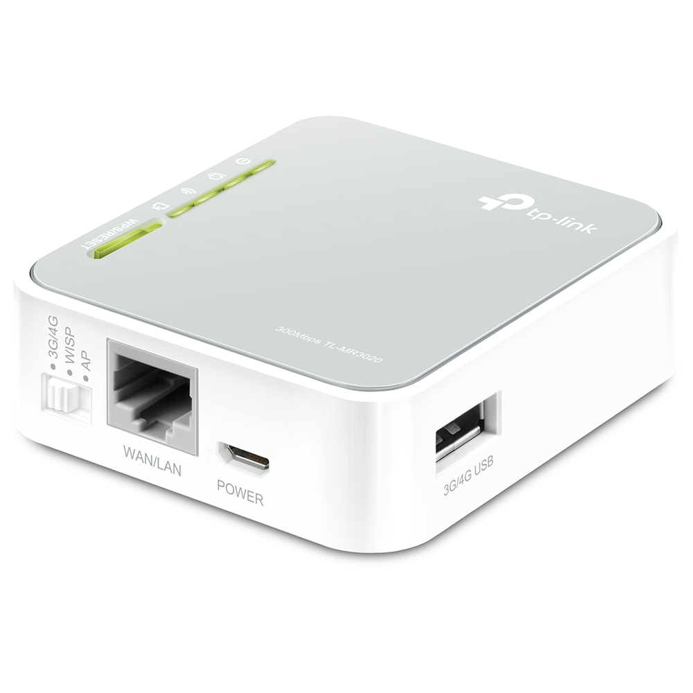
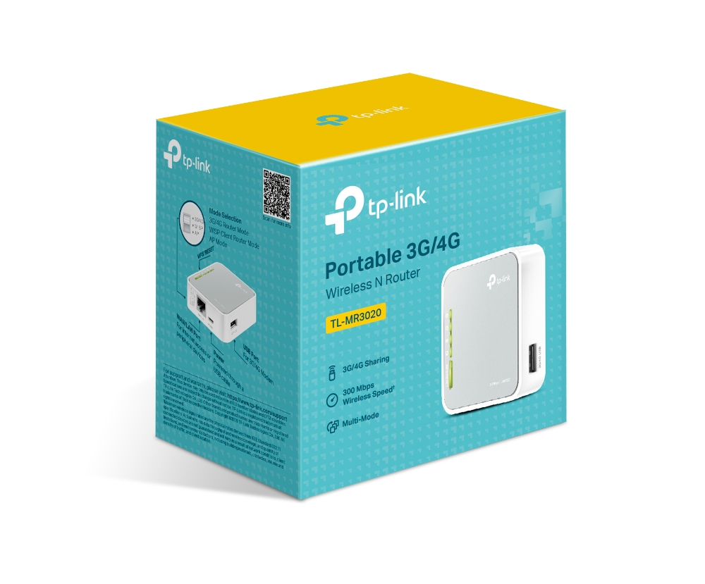

# Фотографии TL-MR3020 / Product photographs

Оригиналы TP-Link сохранены 09.11.2026 без преобразований. / Unmodified TP-Link originals saved 2026-11-09. [URL / SHA256](manifest.json). Права TP-Link сохранены / TP-Link rights retained.

## Ver. 3.30

[USB Type-C — питание / power input](photos/v3.30/tl-mr3020-2.jpg). Поддерживаемый профиль возврата EU 3.30 / Supported recovery profile EU 3.30.

[Страница / Page](https://www.tp-link.com/en/home-networking/5g-4g-router/tl-mr3020/v3.30/) · [HTML](tp-link-mr3020-v3.30-product-en.html).

## Ver. 3.20

Только для сравнения; восстановление не поддерживается / Reference only; recovery unsupported.

[Страница / Page](https://www.tp-link.com/en/home-networking/5g-4g-router/tl-mr3020/v3.20/) · [HTML](tp-link-mr3020-v3.20-product-en.html).

